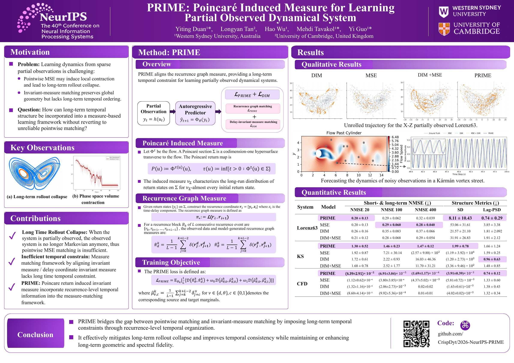

Our paper **PRIME: Poincaré Return Induced Measure for Learning Partially Observed Dynamical Systems** has been accepted at the **40th Conference on Neural Information Processing Systems (NeurIPS 2026)**. This is joint work with Longyan Tan, Hao Wu, Mehdi Tavakol and Yi Guo, from Western Sydney University and the University of Cambridge.

Learning dynamics from sparse partial observations is hard. Pointwise MSE training can induce local contraction and long-term rollout collapse, while invariant-measure matching preserves global geometry but lacks long-term temporal ordering. PRIME closes this gap by aligning **recurrence graph measures** built from consecutive Poincaré return events, which imposes long-term temporal constraints inside a measure-matching framework. We evaluate it on the partially observed Lorenz63 system, the sensor-observed Kuramoto–Sivashinsky equation, and flow past a cylinder.

 [Download the A0 poster (PDF)](PRIME_NeurIPS2026_poster.pdf) &nbsp;·&nbsp;  [Code](https://github.com/CrispDyt/2026-NeurIPS-PRIME) &nbsp;·&nbsp;  [Publication page](/publication/conference-paper/prime-poincare-return-induced-measure/)

